# Trustworthy Brain Tumor Classification from MRI Using Leakage-Aware and Explainable Deep Learning

Major Project-II, Computer Engineering (AI), Marwadi University
**Team:** K Praveen Kumar, Ishika Kaur, Shreesha | **Guide:** Akshara Prachi

4-class classification of brain MRI slices: **glioma, meningioma, notumor, pituitary**.

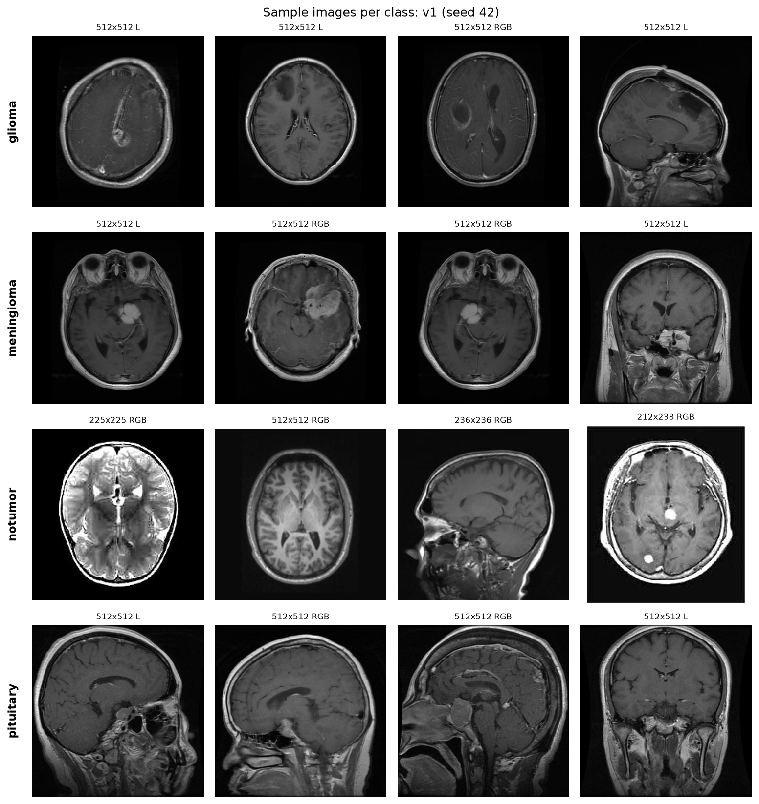

*Example slices from the Kaggle dataset (one row per class), shown for illustration only; the dataset is not redistributed here.*

## Why this project
The popular Kaggle *Brain Tumor MRI Dataset* contains many duplicate and near-duplicate images, and many of them
appear in both the Training and Testing folders. Models trained and tested on the original folders can look far
better than they really are. This project:

1. **Audits duplicates** (MD5 exact copies, perceptual-hash near copies, deep-feature look-alikes) and builds a
   **leakage-free split**. Every model is compared on the original split and on the clean split.
2. Compares **lightweight models** (mobilenetv3_small_100, efficientnet_b0) with **heavy baselines** (vgg16,
   resnet50, densenet121, inception_v3) on accuracy, parameters, size and CPU time per image.
3. Checks **explainability** with Grad-CAM and an *inside-brain ratio* (share of the heatmap inside an Otsu brain
   mask).
4. Adds **calibration and uncertainty**: temperature scaling, ECE, MC dropout, and a "refer to radiologist" flag
   below 0.70 confidence.

## Dataset
[Brain Tumor MRI Dataset](https://www.kaggle.com/datasets/masoudnickparvar/brain-tumor-mri-dataset) by M. Nickparvar
(Kaggle). The dataset is **not included** in this repository. Download it and place it like this:

```
data/
  v1/   Training/{glioma,meningioma,notumor,pituitary}   Testing/{...}   # Kaggle version 1: 7,023 images
  v2/   Training/{...}                                    Testing/{...}   # latest version: 7,200 images
```
`data/` is treated as read-only by all code.

## Repository layout
```
src/
  data.py      file discovery, preprocessing (brain crop + pad + resize 224), image cache, Dataset, transforms
  audit.py     duplicate audit: MD5, pHash, GPU pairwise Hamming distances, union-find duplicate groups
  splits.py    ResNet-50 look-alike features, duplicate clusters, original split and leakage-free clean split
  models.py    the 6 timm models with per-model batch size, image size and precision settings
  train.py     training pipeline (one run per model x split), run summaries, health checks, plots
  evaluate.py  test evaluation: metrics, temperature scaling, ECE, MC dropout, referral rule, latency
  gradcam.py   Grad-CAM of the predicted class, brain mask (Otsu + largest blob + filled holes), inside-brain ratio
  report.py    the six final report figures (colour-blind-safe palette)
notebooks/
  00_data_check.ipynb       counts, versions, corrupt files, image sizes and colour modes
  01_preprocessing.ipynb    crop/resize cache, augmentation, DataLoader speed
  02_duplicate_audit.ipynb  exact and near duplicates, train-test leakage
  03_splits.ipynb           look-alikes, clusters, original and clean splits
  04_training.ipynb         training of all models (settings cell at the top)
  05_heavy_training.ipynb   resnet50 and vgg16 baselines
  06_evaluation.ipynb       test metrics, calibration, MC dropout, referral, size and latency
  07_gradcam.ipynb          Grad-CAM on every test image, inside-brain ratio, galleries
  08_results_plots.ipynb    final figures (outputs/plots/final) and plain-English summary
app/
  app.py            Streamlit demo (upload or sample MRI -> class, calibrated confidence, Grad-CAM, referral banner)
  inference.py      CPU inference helpers that reuse src/ (preprocessing, load_run, temperature, Grad-CAM, MC dropout, referral rule)
  plots.py          matplotlib figures for the app tabs (colour-blind-safe palette)
  make_samples.py   copies the model files and one held-out sample per class into model/ and samples/
  model/            best.pt, config.json, metrics.json, test_logits.npz of mobilenetv3_small_100 on the clean split (in git, 6 MB)
  samples/          four held-out test images, one per class
PROGRESS.md                 week-by-week log of what was done and every result
docs/images/                figures used in this README (copies of selected files from outputs/plots)
outputs/                    generated: cache, audit files, splits, runs, plots (not in git)
```

## Setup
Developed on Windows 11, Python 3.12.5, NVIDIA GTX 1650 Ti (4 GB).
```bash
python -m venv .venv
.venv\Scripts\activate          # Windows
pip install -r requirements.txt  # PyTorch 2.14.1 + CUDA 12.6, timm 1.0.30, ...
```
Run the notebooks in order (00 to 08). Each one writes its results to `outputs/`. Pretrained weights are downloaded
once into `.cache/` inside the project.

## Demo app (Week 10)
```bash
streamlit run app/app.py     # from the project root; runs on the CPU, no GPU needed
```
It opens at http://localhost:8501. The model is `mobilenetv3_small_100` trained on the clean split; `app/model/` holds a copy
of its files from `outputs/runs/`. **It is a research prototype, not a medical device**: it must not be used for any clinical decision.

### How it works
```
upload / sample  ->  greyscale -> crop black border -> pad to square -> resize 224   (same steps as the training cache)
                 ->  MobileNetV3-small (CPU)  ->  logits
                 ->  softmax(logits / T)       T = temperature fitted on the validation set (config.json)
                 ->  confidence = highest probability;  below 0.70 -> red "Refer to radiologist" banner
                 ->  Grad-CAM on the last 7 x 7 feature map  ->  heat map, inside-brain ratio, optional focus circle
                 ->  MC dropout (30 passes on the last layer)  ->  uncertainty
```
All model code is reused from `src/` (`inference.py` is only a thin wrapper); `plots.py` draws the figures and `app.py` the page.
Nothing is typed in by hand: every number on the page is computed for the uploaded image or read from `app/model/metrics.json`
and `test_logits.npz`, which were written by the Week 8 evaluation.

### Screens
**1. Start: upload your own slice or click one of four held-out sample images** (never used in training or validation).
The disclaimer is at the top of the page and in the sidebar.

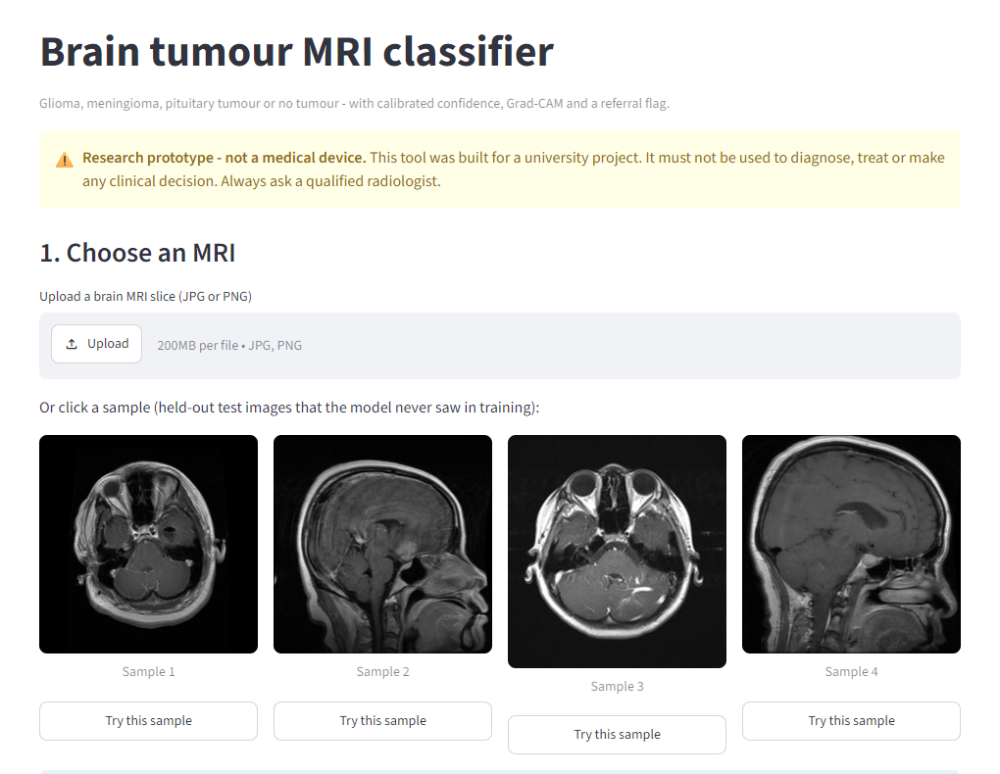

**2. Summary tab.** Predicted class, calibrated confidence for all four classes, the image the network sees, and the Grad-CAM
overlay (cyan line = brain mask). The inside-brain ratio is shown next to the share a uniform heat map would get.
The optional white circle marks the strongest Grad-CAM region, that is **where the model looked, not a tumour outline**:
the model was never trained with tumour outlines and the map is only 7 x 7 cells. In this glioma sample the strongest heat is at the
top edge of the head, which is a good reminder not to read the circle as a tumour location.

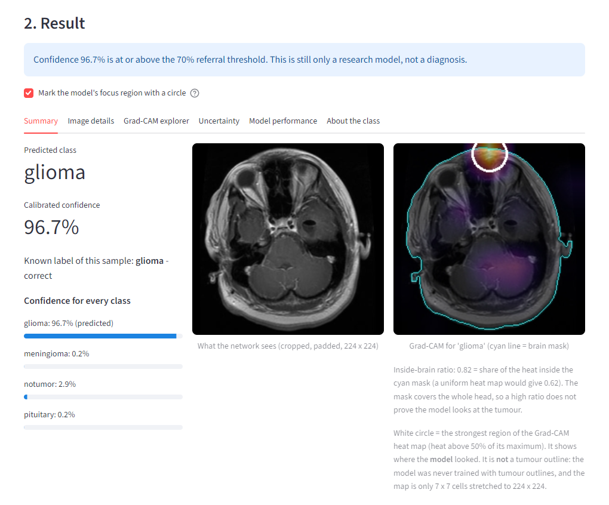

**3. Referral banner.** When the calibrated confidence is below 0.70 the page shows a red "Refer to radiologist" banner
(notumor sample, confidence below the threshold). The circle is off by default when the prediction is "notumor".

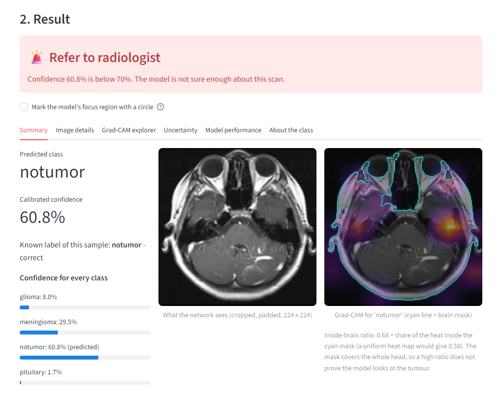

**4. Image details tab.** File facts, the four preprocessing steps (crop box, crop, padded 224 x 224 input, Otsu brain mask),
brightness statistics inside the mask and a brightness histogram.

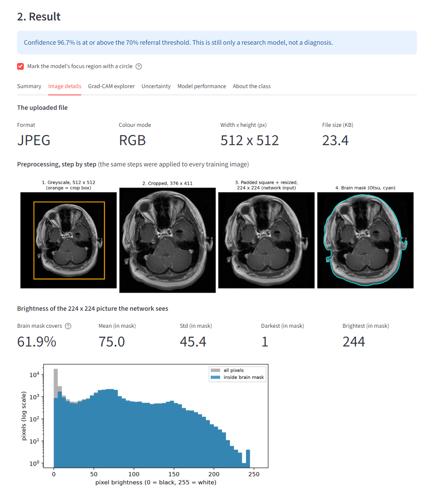

**5. Grad-CAM explorer tab.** Choose any of the four classes to explain (not only the predicted one), change the heat-map
opacity, and see the heat map alone next to the overlay. A warning appears if the focus region lies outside the brain mask.

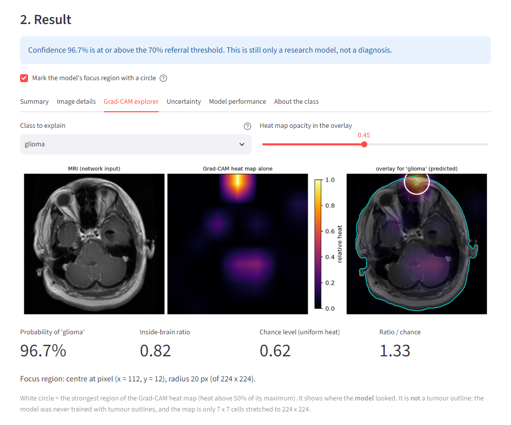

**6. Uncertainty tab.** Left: probabilities before and after temperature scaling with the 0.70 referral line, the margin between
the top two classes and the entropy. Right: 30 MC-dropout passes (bar = mean, whisker = standard deviation, dots = single passes,
diamond = plain prediction). The model was trained without dropout, so single passes vary a lot; look at whether the predicted class
stays the same and at the entropy rather than at the exact numbers.

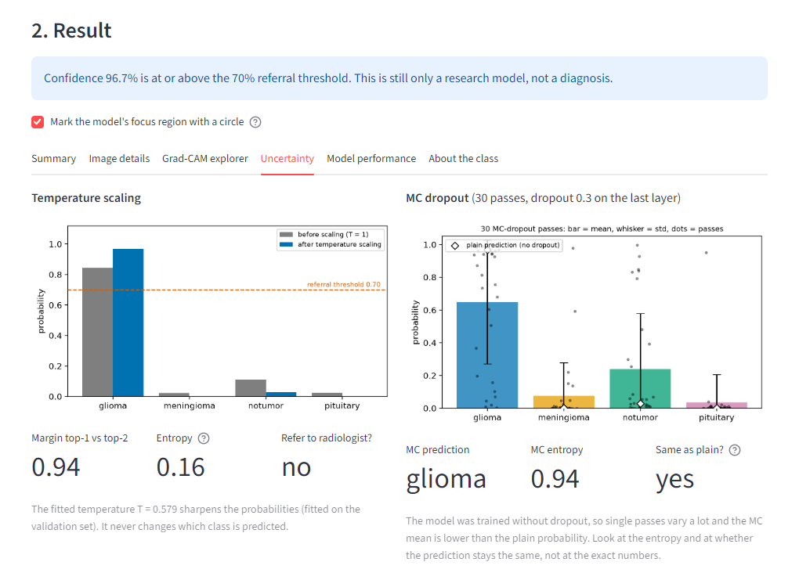

**7. Model performance tab.** How the model did on its own held-out clean test images (not on your upload): confusion matrix,
sensitivity and precision per class, reliability diagram before and after temperature scaling, accuracy versus coverage,
and where the uploaded image's confidence falls among the test images (wrong predictions sit at lower confidence).
A last tab, "About the class", gives a short general description of the predicted class (background text written by the team, not model output).

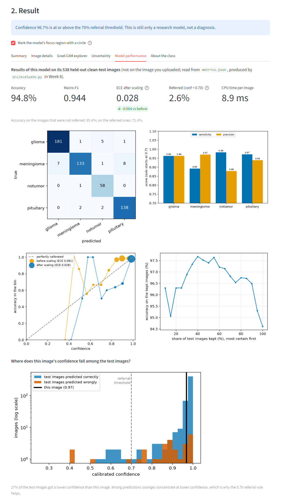

### Known limits
- The model always answers with one of the four classes, also for a picture that is not a brain MRI. The only guard is a warning
  when the crop step finds no clear head region; a black or noise image was still classified with high confidence in our tests.
- Grad-CAM shows where the network looked, not what it understood; the brain mask is really a head mask (it includes skull and scalp).
- One model, one seed, one public dataset (Kaggle, Nickparvar), clean-split test set of 538 images.
- The screenshots were taken from the running app with headless Chrome and show the held-out sample images.

## Training recipe (`src/train.py`)
- timm ImageNet-pretrained backbone with a new 4-class head, channels_last memory layout, seed 42
- AdamW, 1 warm-up epoch, then cosine learning-rate decay; label smoothing 0.1; inverse-frequency class weights
- early stopping on validation macro-F1 (patience 5); only the best checkpoint is kept
- mixed precision (float16) with a NaN guard; efficientnet_b0 trains in float32 (float16 gave NaN on this GPU)
- out-of-memory retry: halve the batch and double gradient accumulation
- every run writes `outputs/runs/<split>/<model>/` with `best.pt`, `history.csv` and `config.json`, and finished
  runs are skipped, so training can be stopped and resumed

## Results
All numbers come from the notebooks (`notebooks/06` to `08`); see `PROGRESS.md` for details and `outputs/results/` for the CSV files.
Test sets were never used for training, early stopping or fitting the calibration temperature.

**Duplicate audit.** v1 has 503 exact-duplicate pairs, v2 has 227. Share of original Testing images with a twin
in Training (any link: exact, near or look-alike): **v1 70.2%, v2 63.1%**; clean split: **0.0%** for both.

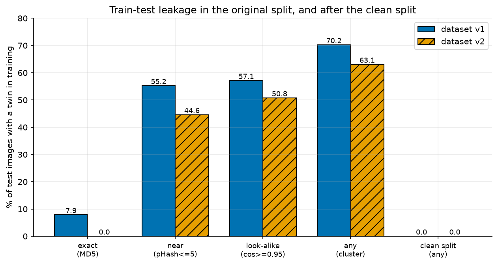

**Splits (train / val / test images):**

| | original | clean |
|---|---|---|
| v1 | 4,855 / 857 / 1,311 | 2,426 / 520 / 520 |
| v2 | 4,760 / 840 / 1,600 | 2,508 / 537 / 538 |

**Test-set results (12 runs).** Each run is scored on its own test set, so original and clean rows use different images.

| Dataset / split | Model | Test images | Accuracy | Macro-F1 | ECE before -> after | Size (MB) | CPU ms/image | Stopped by |
|---|---|---|---|---|---|---|---|---|
| v1 clean | EfficientNet-B0 | 520 | 0.9538 | 0.9541 | 0.091 -> 0.022 | 15.6 | 24.2 | target_acc |
| v1 clean | MobileNetV3-S | 520 | 0.9788 | 0.9756 | 0.110 -> 0.014 | 5.9 | 8.1 | max_epochs |
| v1 clean | ResNet-50 | 520 | 0.9481 | 0.9404 | 0.100 -> 0.014 | 90.0 | 58.8 | target_acc |
| v1 clean | VGG16 | 520 | 0.9269 | 0.9169 | 0.092 -> 0.031 | 512.2 | 283.0 | target_acc |
| v1 original | EfficientNet-B0 | 1311 | 0.9878 | 0.9872 | 0.078 -> 0.007 | 15.6 | 23.7 | patience |
| v1 original | MobileNetV3-S | 1311 | 0.9908 | 0.9905 | 0.074 -> 0.006 | 5.9 | 10.3 | patience |
| v1 original | ResNet-50 | 1311 | 0.8848 | 0.8815 | 0.066 -> 0.039 | 90.0 | 59.7 | target_acc |
| v1 original | VGG16 | 1311 | 0.9184 | 0.9134 | 0.090 -> 0.028 | 512.2 | 239.3 | user_stop |
| v2 clean | EfficientNet-B0 | 538 | 0.9164 | 0.9132 | 0.091 -> 0.032 | 15.6 | 23.0 | target_acc |
| v2 clean | MobileNetV3-S | 538 | 0.9480 | 0.9440 | 0.091 -> 0.028 | 5.9 | 8.9 | patience |
| v2 original | EfficientNet-B0 | 1600 | 0.9406 | 0.9398 | 0.055 -> 0.036 | 15.6 | 21.7 | target_acc |
| v2 original | MobileNetV3-S | 1600 | 0.9344 | 0.9334 | 0.066 -> 0.033 | 5.9 | 11.8 | target_acc |

Training stopped early (`target_acc` = validation accuracy reached 0.92, `user_stop` = stopped by hand) for most heavy and several light
runs, so **original vs clean is not a clean leakage test**: only v1 MobileNetV3-S ran to patience or the epoch limit on both splits
(accuracy 0.9908 original vs 0.9788 clean). Results are single-seed; the clean test sets have 520 and 538 images (one image = 0.19 points).

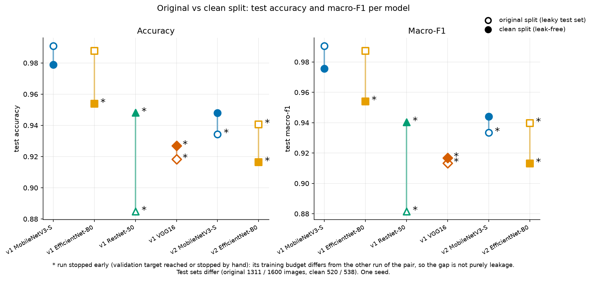

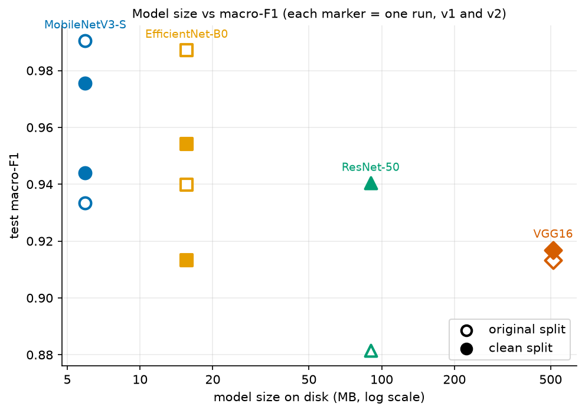

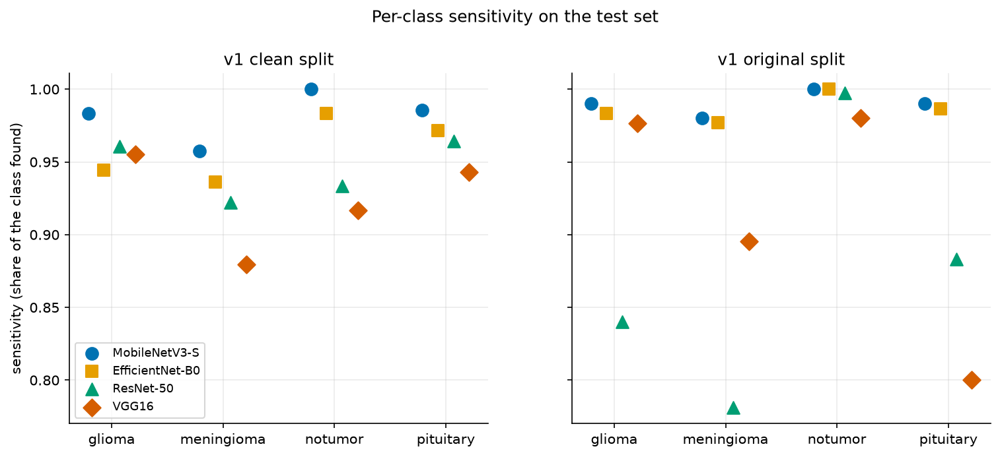

**Calibration and referral.** All 12 runs were under-confident (fitted temperature 0.45 to 0.73). Temperature scaling lowered the ECE in every run
(0.055-0.110 before, 0.006-0.039 after). Referring scans below 0.70 confidence sent 0.3-12% of scans to a radiologist, and accuracy on the scans
that were not referred was higher than the overall accuracy in all 12 runs. MC dropout is post-hoc (the models were trained without dropout).

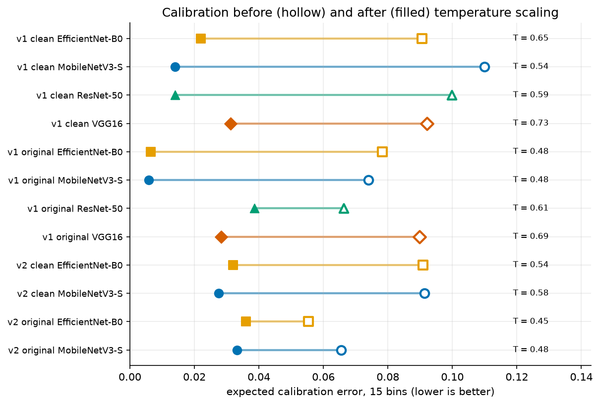

**Grad-CAM and the inside-brain ratio.** Grad-CAM of the predicted class was computed for every test image (11,600 images). The ratio is the share
of the heat inside the brain mask (Otsu, largest component, filled holes); a uniform heat map would score about 0.58. ResNet-50 is highest (0.899 on v1 clean),
then EfficientNet-B0 (0.760) and MobileNetV3-S (0.686); VGG16 is lowest (0.353, below chance: its heat sits on the skull rim and picture borders).
The ratio does not separate correct from wrong predictions. The "brain mask" is really a head-tissue mask (it includes skull and scalp), so a high ratio does not prove
the model looks at the tumour.

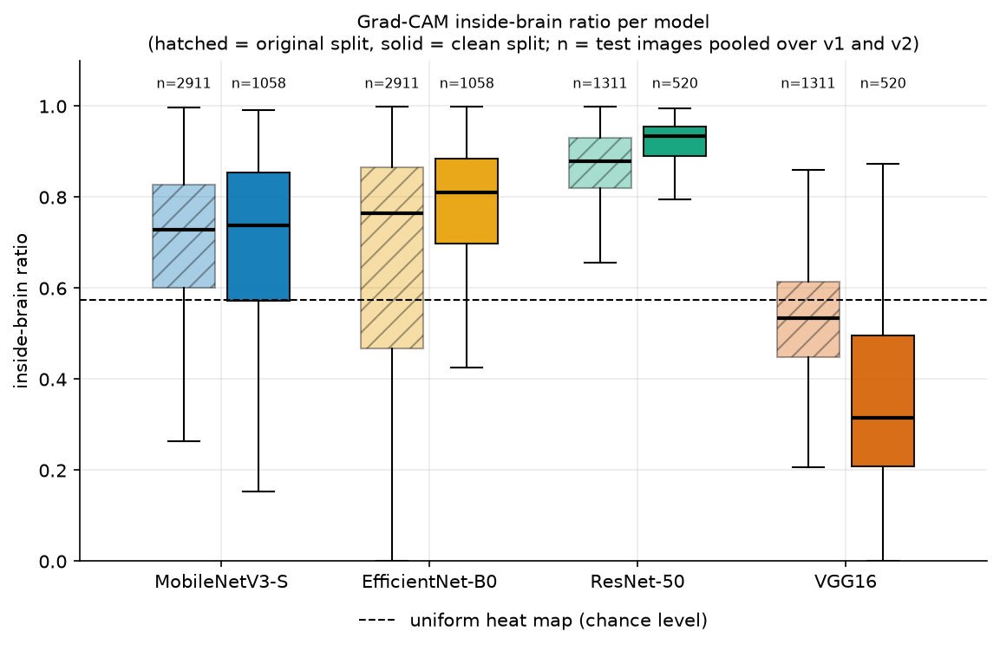

Example Grad-CAM galleries (v1 clean test set, 12 random images, half of them wrong predictions; cyan line = brain mask):

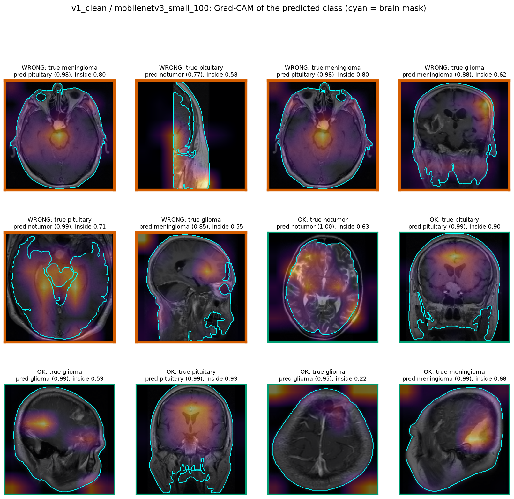

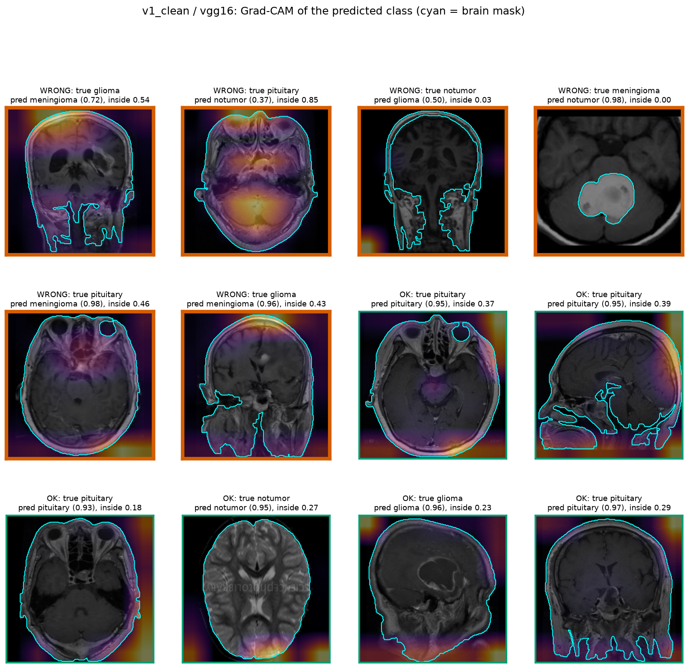

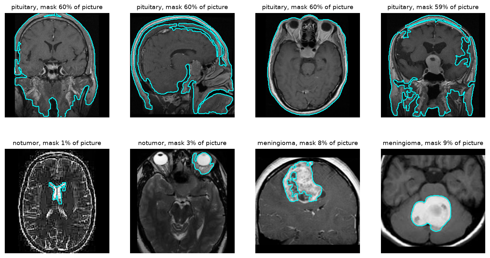

## Status
- [x] Week 1: data check
- [x] Week 2: preprocessing and image cache
- [x] Week 3: duplicate audit (MD5, pHash)
- [x] Week 4: look-alike audit, clusters, original and clean splits
- [x] Week 5: training pipeline
- [x] Week 6: light models on original and clean splits
- [x] Week 7: heavy baselines resnet50 and vgg16 on v1 (densenet121 and inception_v3 not trained)
- [x] Week 8: test-set evaluation, parameters, size, CPU/GPU ms per image, temperature scaling, ECE, MC dropout, referral flag
- [x] Week 9: Grad-CAM and inside-brain ratio, final figures, results summary
- [x] Week 10: Streamlit demo app in `app/`
- [ ] Fair original-vs-clean comparison (equal training budgets) and report writing
